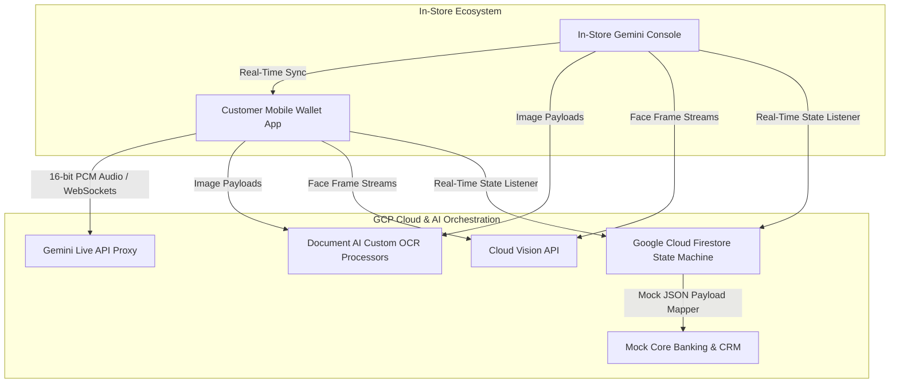
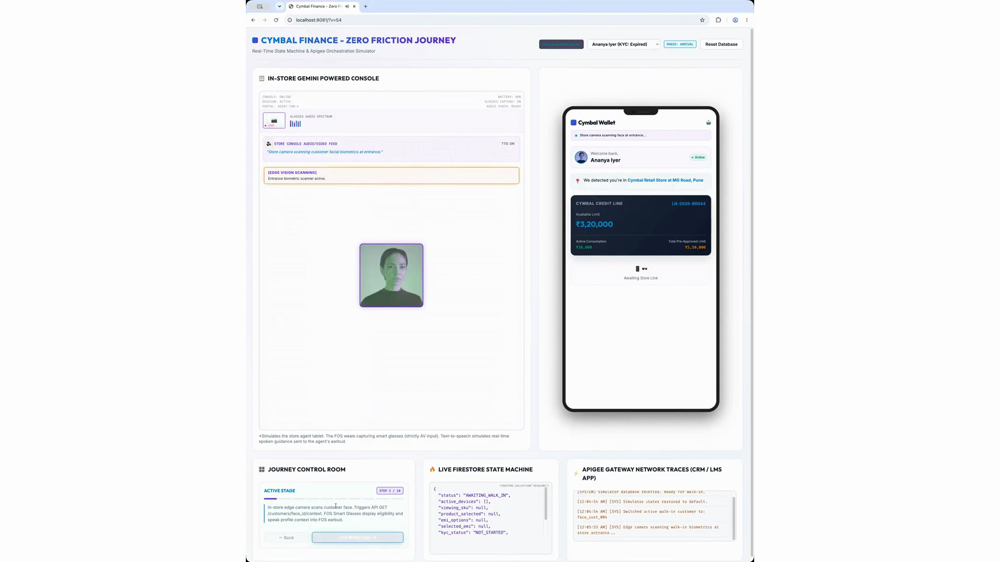
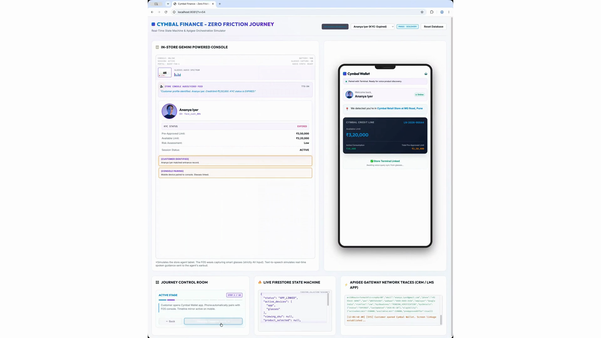
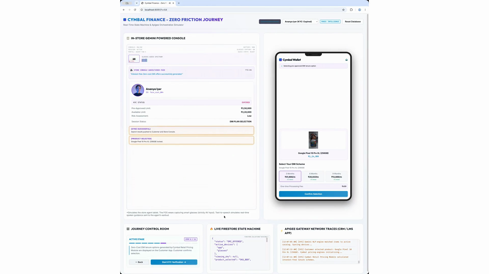
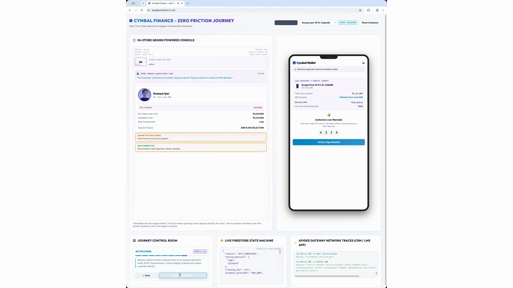
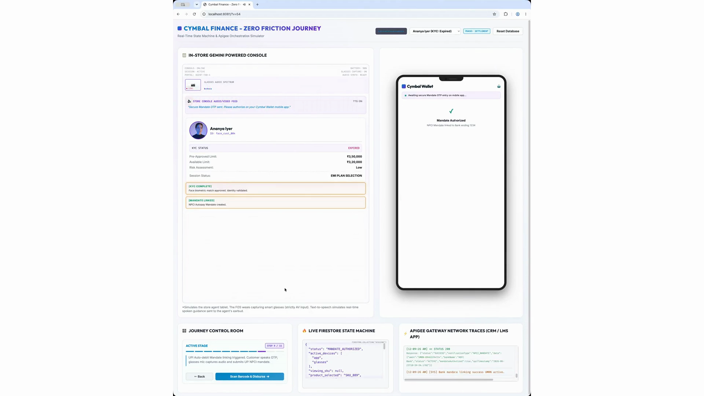
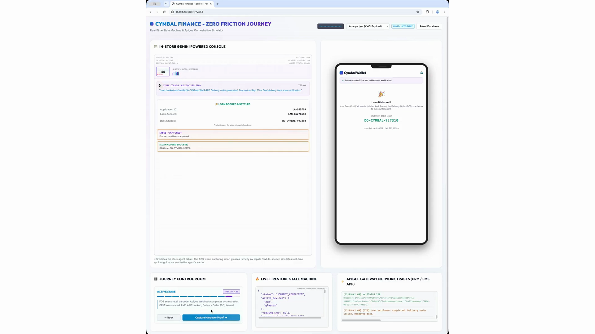
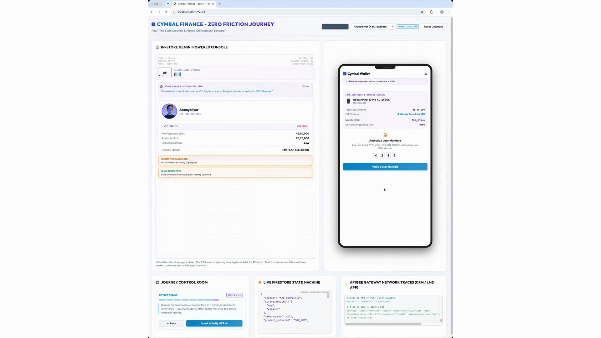
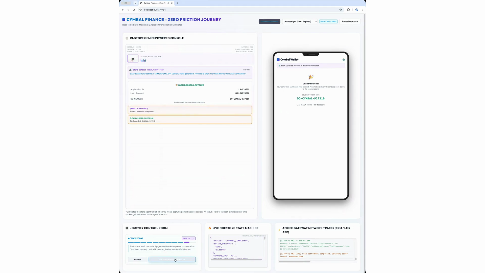
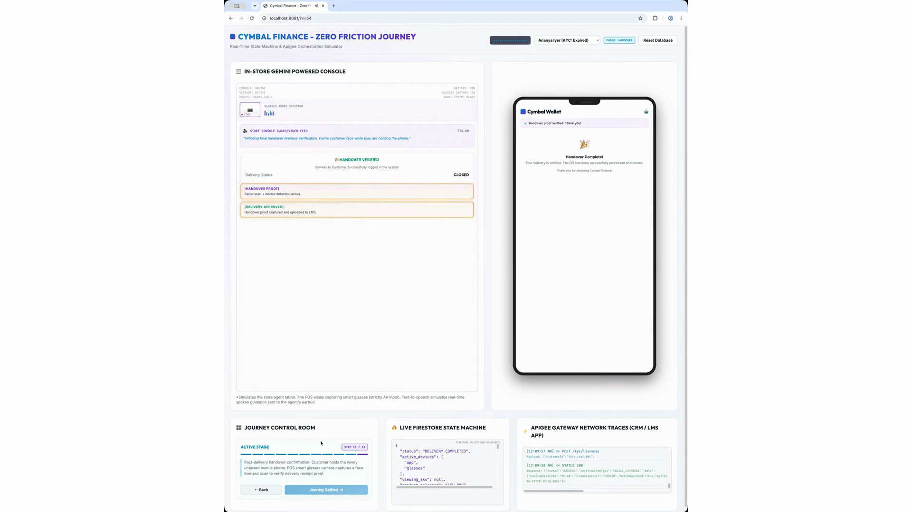

# Product Requirement Document (PRD): Cymbal / Bajaj Zero Friction In-Store Financing Journey

## 1. Document Overview & Executive Summary
This Product Requirement Document (PRD) defines the complete functional and technical specification for the **Zero Friction Agentic AI In-Store Customer Financing Journey**.

The solution enables a friction-free, real-time POS financing experience for retail store customers purchasing high-value products (e.g., electronics, smartphones). By orchestrating an **In-Store Gemini-Powered Console** (Web Dashboard / Admin Control Room) with a **Mobile Customer Wallet App (PWA)**, the system achieves instant product discovery, automated Document AI OCR validation, real-time Firestore state machine updates, and automated Delivery Order (DO) generation.

---

## 2. System Architecture & Dual-Screen Interaction Model

The solution consists of two primary UI interfaces acting in real-time synchronization:



---

## 3. End-to-End User Journey Specification (Step-by-Step)

### Step 1: Customer Entrance & Biometric Profile Identification
- **User Action**: Customer (e.g., Ananya Iyer) walks into the retail store. Edge vision camera scans customer facial biometrics at the entrance.
- **Console System Action**: Matches facial scan against customer registry, identifies pre-approved credit limit (e.g., ₹3,500,000 / ₹3.5 Lakh), and flags card status (e.g., *Expired*).
- **UI Screen Visual**:
  

---

### Step 2: Mobile Wallet Pairing & Real-Time Sync
- **User Action**: Customer opens the Customer Mobile Wallet App on their smartphone.
- **Console & Mobile Action**: App automatically pairs with the Store Terminal (`STORE-TERMINAL-LIVING-001`). Pre-approved credit limit, available balance, and active card consumption are synced to the mobile wallet in real time via Firestore `onSnapshot` listeners.
- **UI Screen Visual**:
  

---

### Step 3: Conversational Voice Product Discovery
- **User Action**: Customer speaks to the terminal / app (*"Show me the Google Pixel 10 Pro XL"*).
- **AI/ML Engine Action**: Client-side VAD filters ambient store noise and streams 16-bit PCM audio over WebSockets to Gemini Live API. Gemini Pro Multimodal invokes NLP matching microservices.
- **Console & Mobile Action**: Search results and matching product specifications render simultaneously on both the In-Store Console and Customer Mobile App.
- **UI Screen Visual**:
  

---

### Step 4: Interest-Free EMI Option Selection
- **User Action**: Customer selects preferred zero-cost EMI plan (e.g., 6 Months @ ₹21,666/mo vs. 12 Months @ ₹10,833/mo) and taps *"Confirm Selection"*.
- **System Action**: State machine updates session state to `PRODUCT_SELECTED`. System detects expired card status and triggers Document AI KYC scanner.
- **UI Screen Visual**:
  

---

### Step 5: Document AI Aadhaar KYC Verification & OTP
- **User Action**: Customer holds Aadhaar Card to the camera. PWA sends image to Document AI custom processor. Customer enters OTP received on mobile app.
- **System Action**: Document AI extracts Aadhaar details, connects to UIDAI central gateway mock endpoint, verifies OTP, and updates Firestore state to `AADHAAR_VERIFIED`.
- **UI Screen Visual**:
  

---

### Step 6: Document AI PAN Card Verification & NSDL Gateway Check
- **User Action**: Customer holds PAN Card to the camera. Enters NSDL verification OTP on mobile app.
- **System Action**: Document AI parses PAN number, validates against NSDL database mock API, confirms identity match, and sets status to `PAN_VERIFIED`. All OVD document verifications are completed.
- **UI Screen Visual**:
  

---

### Step 7: Bank Mandate & NPCI E-Mandate Authorization
- **User Action**: System initiates bank mandate authorization for automated EMI repayment. Customer frames face for biometric match and authorizes NPCI mandate.
- **System Action**: Executes facial liveness match via Cloud Vision API microservice, connects to NPCI gateway mock service, sends mandate OTP, and receives e-mandate approval.
- **UI Screen Visual**:
  

---

### Step 8: Mandate Success & Barcode Scanning Stage
- **User Action**: Screen displays *"Mandate Approved"*. Store sales rep scans the product SKU barcode / IMEI serial on the device box.
- **System Action**: Firestore receives mandate completion confirmation, updates session status to `MANDATE_SUCCESS`, and prepares loan booking payload.
- **UI Screen Visual**:
  

---

### Step 9: Loan Booking & Delivery Order (DO) Generation
- **System Action**: Middleware ingests verified customer data, product SKU, and mandate tokens. It generates mock Salesforce LOS application log (`LN-920102`), books loan in Pennant LMS (`LM-482791`), generates Delivery Order (`DO-CYMBAL-027318`), and pushes DO payload to Firestore.
- **Mobile & Console Action**: Instant visual and audio confirmation triggers on the Customer Wallet App: *"Loan Approved & Delivery Order Generated!"*.
- **UI Screen Visual**:
  

---

### Step 10: Final Handover Liveness Verification & Journey Close
- **User Action**: Sales agent hands over physical product box to customer. Terminal prompts customer to frame face while holding the device box for final delivery proof capture.
- **System Action**: Edge liveness verification completes, uploads delivery proof image to Firestore, updates transaction status to `CLOSED`, and displays *"Handover Completed! Thank You"*.
- **UI Screen Visual**:
  

---

## 4. Technical Specifications & Data Models

### 4.1 Firestore Real-Time State Machine Schema (`sessions/{sessionId}`)
```json
{
  "sessionId": "SESS-2026-0728-9941",
  "terminalId": "STORE-TERMINAL-LIVING-001",
  "status": "CLOSED",
  "customer": {
    "name": "Ananya Iyer",
    "preApprovedCredit": 350000,
    "cardStatus": "EXPIRED",
    "walletPaired": true
  },
  "product": {
    "name": "Google Pixel 10 Pro XL",
    "variant": "256GB Obsidian",
    "retailPrice": 129999,
    "sku": "SKU-GGL-PX10PXL-256"
  },
  "emiPlan": {
    "tenureMonths": 6,
    "monthlyInstallment": 21666,
    "isNoCost": true
  },
  "kycStatus": {
    "aadhaarVerified": true,
    "panVerified": true,
    "livenessVerified": true
  },
  "disbursement": {
    "applicationId": "LN-920102",
    "lmsLoanAccount": "LM-482791",
    "deliveryOrderNumber": "DO-CYMBAL-027318",
    "handoverCompleted": true
  },
  "updatedAt": "2026-07-28T14:58:00Z"
}
```

### 4.2 API Endpoint Contracts (GKE Middleware)
1. **Document OCR Parse**: `POST /api/v1/ocr/parse` (Ingests multipart image -> returns structured fields).
2. **Financing Eligibility Evaluation**: `POST /api/v1/financing/calculate` (Ingests SKU, tenure -> evaluates against static matrix).
3. **Disbursement & DO Handoff**: `POST /api/v1/disbursement/generate-do` (Triggers mock Salesforce/LMS payload mapping -> returns DO Number).

---

## 5. Non-Functional Requirements & Guidance for Coding Agents

1. **State Synchronization**: All state changes **must** use Firestore `onSnapshot` subscriptions. Do not implement polling mechanisms (`setInterval` / HTTP polling).
2. **Offline Tolerance**: Initialize Firestore Web SDK with persistent local caching enabled (`enableIndexedDbPersistence`).
3. **Responsive UI Rules**:
   - In-Store Console: Optimized for 1080p widescreen desktop / tablet landscape.
   - Customer Wallet App: Optimized for mobile viewport (PWA portrait view).
4. **Mock Data Isolation**: Keep all external core banking and CRM integrations strictly mocked via JSON files under `src/mocks/`.
