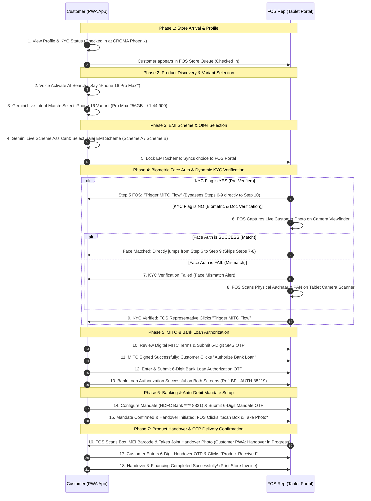

# Bajaj Finance x CROMA Store — Dual User Journey Wireframe Specification

This document defines the synchronized 18-step user journey and wireframe architecture for an existing **Bajaj Finance (BFL)** customer walking into a **CROMA retail store** and interacting with the store's **Feet On Street (FOS) representative** via tablet.

---

## 1. Executive Summary & Architecture

> [!IMPORTANT]
> **Dual Synchronized Journeys**: The experience consists of two synchronized interfaces that update in real time as the customer and store representative progress through store check-in, Gemini Live AI voice product discovery, EMI offer selection, face authentication, KYC branching, MITC approval, bank loan authorization, auto-debit mandate OTP setup, IMEI barcode scanning, and OTP-verified product handover.

```
+-----------------------------------------------------------------------+
|                       CROMA STORE ENVIRONMENT                         |
|                                                                       |
|   +-------------------------------+   +---------------------------+   |
|   |      CUSTOMER PWA APP         |   |     FOS TABLET PORTAL     |   |
|   |       (Mobile Screen)         |   |      (Tablet Screen)      |   |
|   |                               |   |                           |   |
|   |  - Profile & Store Checked In |   |  - Live Store Queue       |   |
|   |  - Gemini Live AI Voice Search|   |  - Customer Status Sync   |   |
|   |  - Variant & EMI Scheme Lock  |   |  - Confirmed Offer Review |   |
|   |  - Face Auth Waiting Status   |   |  - Face Auth Camera Feed  |   |
|   |  - Dynamic KYC Status Sync    |   |  - Aadhaar/PAN Scanner    |   |
|   |  - MITC Terms & SMS OTP       |   |  - Trigger MITC Flow      |   |
|   |  - Bank Loan Authorization OTP|   |  - Loan Auth Progress     |   |
|   |  - Bank Mandate E-Sign OTP    |   |  - Mandate Setup Status   |   |
|   |  - Handover in Progress Status|   |  - IMEI Scan & Joint Photo|   |
|   |  - Product Received Handover  |   |  - Handover OTP Status    |   |
|   |    Confirmation via OTP       |   |  - Store Receipt Print    |   |
|   +---------------+---------------+   +-------------+-------------+   |
|                   |                                 |                 |
+-------------------|---------------------------------|-----------------+
                    |       Real-Time Event Sync      |
                    +---------------------------------+
```

---

## 2. End-to-End Sequence Diagram (18 Synchronized Steps)



---

## 3. Screen-by-Screen Wireframe Breakdown

| Step | Device | Screen Title | Primary Elements & UI Behavior |
| :---: | :--- | :--- | :--- |
| **1** | Customer PWA & FOS | View Profile & KYC Status | **Customer PWA**: Profile Avatar (Rahul Sharma), Phone (+91 98765-43210), Store Location (📍 CROMA Phoenix), KYC Status (`Verified` vs `Pending`), "Search Products →" button.<br>**FOS Portal**: Live Store Queue with Rahul Sharma (`Checked In`, Store: CROMA Phoenix, KYC Flag). |
| **2** | Customer PWA & FOS | AI Voice Product Search | **Customer PWA**: Pulsing Voice Search Microphone ("Say 'Show iPhone 16 Pro Max'"). Tap microphone or speak to search.<br>**FOS Portal**: FOS Portal CROMA Store view waiting for customer choice. |
| **3** | Customer PWA & FOS | Voice Intent & Select iPhone 16 Variant | **Customer PWA**: Top Gemini Live Voice AI banner ("Say 'Show iPhone 16 Pro Max' or 'Select 128GB'"), variant cards: **iPhone 16 Pro Max 256GB** (`₹1,44,900`), **iPhone 16 Pro 128GB** (`₹1,19,900`), **iPhone 16 Standard 128GB** (`₹79,900`). "Select iPhone 16 Pro Max →" button.<br>**FOS Portal**: CROMA Store view continues waiting. |
| **4** | Customer PWA & FOS | Voice Scheme Assistant & Select Bajaj EMI | **Customer PWA**: Top Gemini Live Scheme Assistant ("Say 'Go ahead with Zero Down Payment scheme'"), confirmed product banner (`iPhone 16 Pro Max 256GB - ₹1,44,900`), Scheme A (No Cost EMI ₹24,150 x 6m) vs Scheme B (Zero Down ₹28,980 x 5m). "Select Scheme A →" button.<br>**FOS Portal**: CROMA Store view continues waiting. |
| **5** | Customer PWA & FOS | Lock EMI Scheme -> FOS Portal Updated | **Customer PWA**: Scheme A Locked confirmation card. If KYC=NO, prompts customer to visit FOS desk; if KYC=YES, displays Pre-Verified status.<br>**FOS Portal**: Real-time sync displays confirmed product & offer. If `KYC=YES` $\rightarrow$ button **`"⚡ Trigger MITC Flow →"`** (skips Steps 6-9 directly to Step 10); if `KYC=NO` $\rightarrow$ button **`"📸 Enable Face Auth Camera →"`** (advances to Step 6). |
| **6** | FOS Tablet & Customer PWA | Live Face Authentication Camera | **FOS Portal**: Live camera viewfinder with face oval alignment guide and button **`"📸 Submit Face Auth →"`**.<br>**Branching**: If `Face Auth = SUCCESS` $\rightarrow$ directly jumps to Step 9; if `Face Auth = FAIL` $\rightarrow$ advances to Step 7.<br>**Customer PWA**: Passive waiting card (`"⏳ Live Face Authentication — Camera Active on FOS Tablet"`). |
| **7** | FOS Tablet & Customer PWA | Face Auth Failed — KYC Scan Required *(If FAIL)* | **FOS Portal**: Red mismatch alert (`"⚠️ Face Authentication Mismatch"`) with button **`"📄 Scan Aadhaar & PAN on Tablet →"`**.<br>**Customer PWA**: Displays `"⚠️ KYC Verification Failed — Representative will scan Aadhaar & PAN on tablet"`. |
| **8** | FOS Tablet & Customer PWA | Capture Aadhaar & PAN on Tablet *(If FAIL)* | **FOS Portal**: Dual document scanner viewfinder for Aadhaar Card (Front/Back) and PAN Card OCR ingestion with button **`"📤 Submit & Verify Documents →"`**.<br>**Customer PWA**: Displays `"⚠️ KYC Verification Failed — Representative scanning documents"`. |
| **9** | Customer PWA & FOS | KYC Verified -> FOS Trigger MITC | **Customer PWA**: Green badge (`"✅ KYC Verified Successfully"`), awaiting representative to trigger terms.<br>**FOS Portal**: Displays `"✅ KYC Verified"` with button **`"⚡ Trigger MITC Flow →"`**. |
| **10** | Customer PWA & FOS | MITC Terms & OTP Verification | **Customer PWA**: Scrollable MITC terms card, 6-digit SMS OTP input (`[4] [8] [2] [9] [1] [6]`), and button **`"🔐 Verify OTP & Agree"`**.<br>**FOS Portal**: Displays `"⏳ MITC Signing in Progress"` (`SIGNING IN PROGRESS` badge). |
| **11** | Customer PWA & FOS | MITC Signed -> Authorize Bank Loan | **Customer PWA**: Displays `"✅ MITC Agreement Signed Successfully — MITC Terms Verified"`, loan product breakdown, and button **`"Authorize Bank Loan →"`**.<br>**FOS Portal**: Displays `"✅ MITC Signed by Customer"` (`MITC SIGNED` badge). |
| **12** | Customer PWA & FOS | Enter & Submit Loan Authorization OTP | **Customer PWA**: Authorize Bank Loan screen, loan principal (₹1,44,900), EMI (₹24,150/mo), 6-digit OTP input (`[7] [3] [9] [1] [4] [0]`), and button **`"🔐 Submit Loan Authorization OTP →"`**.<br>**FOS Portal**: Displays `"⏳ Loan Authorization in Progress"` (`AUTHORIZATION IN PROGRESS` badge). |
| **13** | Customer PWA & FOS | Bank Loan Authorization Successful | **Customer PWA**: Green checkmark (`"✅ Bank Loan Authorization Successful!"`), sanctioned breakdown, Ref: `BFL-AUTH-88219`, and button **`"Confirm Mandate via OTP →"`**.<br>**FOS Portal**: Displays `"✅ Bank Loan Authorization Successful"` (`LOAN AUTHORIZED` badge, Ref: `BFL-AUTH-88219 ✅`). |
| **14** | Customer PWA & FOS | Configure Mandate Details & Submit OTP | **Customer PWA**: Auto-debit bank account (`HDFC Bank **** 8821`, NPCI E-Mandate, Locked EMI: ₹24,150/mo), 6-digit Mandate E-Sign OTP input (`[5] [1] [8] [3] [9] [2]`), and button **`"🔐 Submit Mandate OTP →"`**.<br>**FOS Portal**: Displays `"⏳ Mandate OTP Validation in Progress"` (`MANDATE OTP ACTIVE` badge). |
| **15** | Customer PWA & FOS | Mandate Confirmed & Handover Initiated | **Customer PWA**: Displays `"✅ Mandate Details Confirmed — Handover Initiated!"` and button `"Awaiting Representative Handover →"`.<br>**FOS Portal**: Displays `"⚡ Mandate Confirmed: Scheme A (No Cost EMI)"` with button **`"📸 Scan Box & Take Handover Photo →"`**. |
| **16** | FOS Tablet & Customer PWA | Product IMEI Scan & Handover in Progress | **FOS Portal**: Barcode scanner viewfinder scanning device IMEI and joint photo with customer, with button **`"📸 Submit Handover Scan & Trigger Customer OTP →"`**.<br>**Customer PWA**: Displays `"⏳ Product Handover in Progress"` with live status. |
| **17** | Customer PWA & FOS | Confirm Product Handover via OTP | **Customer PWA**: Shows verified device details, scanned IMEI (`359128091283719 ✅`), 6-digit Handover OTP input (`[9] [4] [2] [1] [6] [8]`), and button **`"📦 Product Received →"`**.<br>**FOS Portal**: Displays `"⏳ Awaiting Customer OTP Confirmation"` (`HANDOVER OTP ACTIVE` badge). |
| **18** | FOS Tablet & Customer PWA | Transaction Completed Status | **Customer PWA**: Green celebratory screen (`"🎉 Order & Handover Complete!"`), loan reference (`#BFL-2026-88923`), and product receipt summary.<br>**FOS Portal**: Celebratory banner (`"🎉 Handover & Financing Complete!"`) with button **`"🖨️ Print CROMA Store Receipt"`**. |

---

## 4. Key Interactive Wireframe Features

- **Dual-Device Viewport**: Simulate both smartphone (Customer PWA) and tablet (FOS Portal) viewports side-by-side.
- **Interactive 18-Step Timeline**: Clickable progress timeline to step forward, step backward, or jump directly across all 18 journey states.
- **Dual Dynamic Branching Switches**:
  1. **Customer KYC Flag Switch (`KYC = YES` vs `KYC = NO`)**:
     - `KYC = YES`: Step 5 FOS portal shows "Trigger MITC Flow" and skips Steps 6–9 directly to Step 10.
     - `KYC = NO`: Directs customer to Step 6 Face Auth.
  2. **Face Auth Result Switch (`SUCCESS` vs `FAIL`)**:
     - `SUCCESS`: Live face matched $\rightarrow$ Step 6 immediately jumps to Step 9 KYC Verified.
     - `FAIL`: Face mismatch $\rightarrow$ advances to Step 7 (Failure Alert) and Step 8 (Aadhaar & PAN Scanner).
- **Two-Stage Authorization & Mandate Verification**:
  - Step 11-13: Bank Loan Authorization via SMS OTP.
  - Step 14-15: Auto-Debit Bank Mandate E-Sign via SMS OTP.
- **OTP-Verified Physical Handover**: Step 16-17 replaces passive acceptance with active IMEI barcode capture and customer OTP validation for device receipt.
- **Real-Time Cross-Device Sync**: Every action on Customer PWA instantly updates visual status badges and workspace controls on the FOS Tablet Portal.