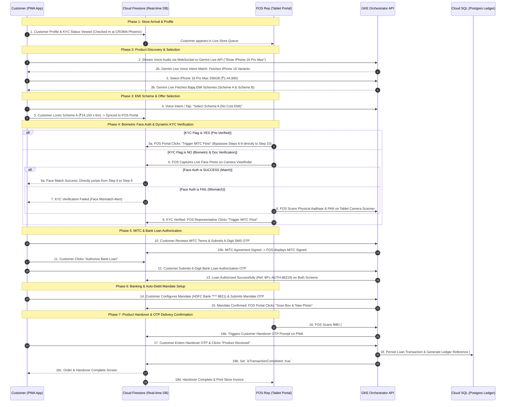

# Bajaj Finance × CROMA In-Store Financing Platform
## Google Cloud Platform (GCP) Solution Design Document (HLD & LLD)

---

### Document Information
- **Project Name**: Bajaj Finance (BFL) × CROMA In-Store Financing Platform
- **Document Type**: High-Level Design (HLD) & Low-Level Design (LLD)
- **Target Cloud Environment**: Google Cloud Platform (GCP)
- **Deployment Platform**: Google Kubernetes Engine (GKE) Enterprise
- **Document Version**: 1.2.0
- **Status**: APPROVED / ARCHITECTURE BASELINE (18-Step Dual Journey)
- **Classification**: Confidential / BFL-CROMA Architecture Specification

---

## Table of Contents
1. [Executive Summary & Business Objectives](#1-executive-summary--business-objectives)
2. [High-Level Design (HLD)](#2-high-level-design-hld)
   - 2.1 [End-to-End Enterprise Architecture Diagram](#21-end-to-end-enterprise-architecture-diagram)
   - 2.2 [Core Architecture Components & GCP Services Mapping](#22-core-architecture-components--gcp-services-mapping)
   - 2.3 [Dual Journey Synchronization & Data Pipeline Architecture](#23-dual-journey-synchronization--data-pipeline-architecture)
   - 2.4 [Network & Edge Architecture](#24-network--edge-architecture)
   - 2.5 [Security, IAM & Regulatory Compliance Architecture (RBI & DPDP Act)](#25-security-iam--regulatory-compliance-architecture-rbi--dpdp-act)
3. [Low-Level Design (LLD)](#3-low-level-design-lld)
   - 3.1 [Database Architecture & Data Schemas](#31-database-architecture--data-schemas)
     - 3.1.1 [Cloud Firestore Real-Time NoSQL Schema](#311-cloud-firestore-real-time-nosql-schema)
     - 3.1.2 [Cloud SQL (PostgreSQL) Transactional DDL & ERD](#312-cloud-sql-postgresql-transactional-ddl--erd)
   - 3.2 [API Specifications & Communication Protocols](#32-api-specifications--communication-protocols)
     - 3.2.1 [RESTful Microservices API Specification](#321-restful-microservices-api-specification)
     - 3.2.2 [WebSocket Gemini Live Voice Streaming Protocol](#322-websocket-gemini-live-voice-streaming-protocol)
   - 3.3 [18-Step End-to-End State Machine & Sequence Flows](#33-18-step-end-to-end-state-machine--sequence-flows)
   - 3.4 [Offline Synchronization & Conflict Resolution Strategy](#34-offline-synchronization--conflict-resolution-strategy)
   - 3.5 [GKE Deployment Architecture & Workload Configuration](#35-gke-deployment-architecture--workload-configuration)
   - 3.6 [Observability, SRE & Incident Management](#36-observability-sre--incident-management)
4. [Disaster Recovery, High Availability & Capacity Planning](#4-disaster-recovery-high-availability--capacity-planning)
5. [Traceability Matrix & PRD Mapping](#5-traceability-matrix--prd-mapping)

---

## 1. Executive Summary & Business Objectives

The **Bajaj Finance (BFL) × CROMA In-Store Financing Platform** is a real-time, hybrid-cloud in-store point-of-sale financing system. It synchronizes the omnichannel customer experience across two active touchpoints in physical CROMA retail outlets:
1. **Customer PWA (Mobile Browser)**: Customer-facing Progressive Web App facilitating store check-in, AI-powered conversational voice discovery via **Gemini Live API**, dynamic EMI offer selection, KYC document capture, digital MITC execution, SMS OTP-based Bank Loan Authorization, NPCI E-Mandate configuration, and OTP-confirmed physical product receipt.
2. **FOS Tablet Portal (Store Representative)**: Representative-facing tablet web application allowing Feet-on-Street (FOS) agents to monitor the live store queue, conduct biometric/camera Face Authentication, trigger MITC signing, track real-time loan authorization & mandate statuses, perform IMEI barcode serial scanning, and execute verified product delivery handover.

### Key Architectural Drivers
- **Sub-Second Real-Time Synchronization**: Instant state synchronization between Customer PWA and FOS Tablet without manual page refreshes or polling.
- **Offline-First PWA Resilience**: Uninterrupted offline customer interactions during store Wi-Fi or cellular dead zones, seamlessly resynchronizing upon network reconnection via Cloud Firestore Web SDK native delta caches.
- **Multimodal Conversational Voice AI**: Low-latency bidirectional voice audio streaming powered by **Gemini Live Multimodal API** (Gemini 2.5 Flash).
- **Strict Data Partitioning**: Real-time ephemeral state stored in **Cloud Firestore (GCP Native)**; authoritative transactional settlement, loan ledgers, and audit trails persisted in **Cloud SQL (PostgreSQL)** via Cloud SQL Auth Proxy sidecars.
- **Two-Stage Financial Authorization & Verification**:
  - *Stage 1*: SMS OTP Bank Loan Authorization (Sanction Ref: `BFL-AUTH-88219`).
  - *Stage 2*: NPCI E-Mandate Bank Auto-Debit E-Sign via SMS OTP.
- **OTP-Verified Physical Handover**: Barcode scanning of device IMEI combined with customer Handover Confirmation OTP before transaction ledger settlement.

---

## 2. High-Level Design (HLD)

### 2.1 End-to-End Enterprise Architecture Diagram

```
+---------------------------------------------------------------------------------------------------+
|                                     PHYSICAL CROMA RETAIL STORE                                   |
|                                                                                                   |
|    +----------------------------------+                   +----------------------------------+    |
|    |      CUSTOMER SMARTPHONE         |                   |        FOS SALES TABLET          |    |
|    |  (React 18 PWA / ServiceWorker)  |                   |    (React 18 Tablet Web App)     |    |
|    |  - Location Check-in             |                   |  - Live Store Queue              |    |
|    |  - Gemini Live Audio Capture     |                   |  - Camera Face Auth Capture      |    |
|    |  - EMI Variant & Plan Selection  |                   |  - IMEI Barcode Scan Engine      |    |
|    |  - Loan & Mandate OTP Auth       |                   |  - MITC & Mandate Status Sync    |    |
|    |  - Product Received OTP Ack      |                   |  - Delivery Verification         |    |
|    |  - Offline IndexedDB Cache       |                   |  - Store Receipt Print           |    |
|    +-----------------+----------------+                   +-----------------+----------------+    |
|                      |                                                      |                     |
+----------------------|------------------------------------------------------|---------------------+
                       | (HTTPS / WSS)                                        | (HTTPS)
                       ▼                                                      ▼
+---------------------------------------------------------------------------------------------------+
|                                  GOOGLE CLOUD PLATFORM (GCP) INGRESS                              |
|                                                                                                   |
|                     [ Cloud Armor WAF / DDoS Mitigation / Rate Limiting ]                         |
|                                              │                                                    |
|                   [ External Application Load Balancer (GCLB HTTP(S)) ]                           |
|                         ├── Edge Caching: Cloud CDN (Frontend Bundles)                            |
|                         ├── WebSocket Ingress: `/ws/gemini-live/*`                                |
|                         └── REST Ingress: `/api/v1/*`                                             |
+----------------------------------------------│----------------------------------------------------+
                                               ▼
+---------------------------------------------------------------------------------------------------+
|                           VPC: `bfl-croma-production-vpc` (asia-south1)                           |
|                                                                                                   |
|  +---------------------------------------------------------------------------------------------+  |
|  |                  GKE CLUSTER (Private Endpoint / Workload Identity Enabled)                 |  |
|  |                                                                                             |  |
|  |   [ Frontend Pods (Nginx) ] ── Serves compiled React PWA & Tablet Portal Bundles            |  |
|  |                                                                                             |  |
|  |   [ Backend Orchestration Pods (FastAPI / Python 3.11 Async) ]                              |  |
|  |     ├── FastAPI Router & State Transition Engine (18-Step Machine)                          |  |
|  |     ├── WebSocket Audio Streaming Gateway ◄──► [ Gemini Live API / Vertex AI ]              |  |
|  |     ├── KYC Verification & Document Ingestion Orchestrator                                  |  |
|  |     ├── Dual-Stage OTP Service (Loan Auth OTP, Mandate OTP, Handover OTP)                   |  |
|  |     └── Sidecar Container: [ Cloud SQL Auth Proxy (localhost:5432) ]                        |  |
|  +--------------------------------------------│------------------------------------------------+  |
|                                               │                                                   |
|  +--------------------------------------------▼------------------------------------------------+  |
|  |                       PRIVATE MANAGED PERSISTENCE LAYER                                     |  |
|  |                                                                                             |  |
|  |  +---------------------------------------+   +-------------------------------------------+  |  |
|  |  |      CLOUD FIRESTORE (GCP Native)     |   |      CLOUD SQL (PostgreSQL 16 HA)         |  |  |
|  |  |  (Real-Time Journey Session State)    |   |     (Authoritative System of Record)      |  |  |
|  |  |  - `journey_sessions/{sessionId}`     |   |  - `customers` table                      |  |  |
|  |  |  - Bi-directional Real-Time Sync     |   |  - `loans_master` table                   |  |  |
|  |  |  - Offline Client IndexedDB Cache     |   |  - `kyc_audit_trail` table                |  |  |
|  |  +---------------------------------------+   +-------------------------------------------+  |  |
|  |                                                                                             |  |
|  |  +---------------------------------------------------------------------------------------+  |  |
|  |  |  CLOUD STORAGE (GCS Bucket - Dual Region asia1)                                       |  |  |
|  |  |  - Encrypted Customer KYC Documents (Aadhaar/PAN)                                     |  |  |
|  |  |  - FOS Face Verification Photos & Handover Joint Photo Proofs                          |  |  |
|  |  +---------------------------------------------------------------------------------------+  |  |
|  +---------------------------------------------------------------------------------------------+  |
+---------------------------------------------------------------------------------------------------+
```

---

### 2.2 Core Architecture Components & GCP Services Mapping

| Architectural Tier | GCP Service Selected | Technical Responsibility & Architectural Justification |
| :--- | :--- | :--- |
| **Edge & Ingress Tier** | **Google Cloud Armor + GCLB + Cloud CDN** | DDoS defense, OWASP top 10 filtering, geo-fencing to India IP blocks, SSL termination, and sub-50ms static bundle delivery to customer mobile devices. |
| **Frontend Hosting** | **GKE Nginx Container Pods** | Multi-replica stateless Nginx pods hosting Vite-compiled React PWA and Tablet Portal assets with optimized gzip/brotli compression. |
| **Microservices Backend** | **GKE Kubernetes Cluster (`asia-south1`)** | High-throughput asynchronous Python FastAPI containers handling business rules, multi-stage OTP validation, loan orchestration, and Cloud SQL sidecar connectivity. |
| **Conversational Voice AI** | **Gemini Live Multimodal API (Gemini 2.5 Flash)** | Ultra-low latency voice recognition and intent extraction streamed over WebSockets directly from the customer's Web Audio API. |
| **Real-Time Data Sync** | **Cloud Firestore (GCP Native Mode)** | Real-time session replication between PWA and FOS Tablet. Enables native client-side IndexedDB caching for offline resilience. |
| **Transactional Ledger** | **Cloud SQL for PostgreSQL 16 (HA Regional)** | Authoritative ACID System of Record for settled loan contracts, disbursement ledgers, customer master, and compliance audit logs. |
| **Encrypted Blob Storage** | **Cloud Storage (GCS Bucket)** | Multi-regional private bucket with Customer-Managed Encryption Keys (CMEK via Cloud KMS) for storing customer KYC documents and handover proof photos. |
| **Security & Secrets** | **Cloud KMS + Secret Manager + Workload Identity** | Eliminates hardcoded service account keys; allows GKE Kubernetes Service Accounts (KSA) to assume Google Service Accounts (GSA) securely. |
| **Observability & SRE** | **Google Cloud Operations Suite (Log, Trace, Monitor)** | Distributed tracing across FastAPI, WebSocket audio sessions, Cloud SQL query latency profiling, and automated alerts. |

---

### 2.3 Dual Journey Synchronization & Data Pipeline Architecture

```
+------------------------------------------------------------------------------------------------+
|                                    DATA SYNCHRONIZATION PIPELINE                               |
|                                                                                                |
|     CUSTOMER PWA                  GCP CLOUD FIRESTORE                      FOS TABLET          |
|    [ Local State ]                (Document: `SESSION-88923`)            [ Live View ]         |
|           │                                    │                               │               |
|           │── Step 1-5: Product & Scheme ────►│                               │               |
|           │   Updates `selectedProduct`        │────── Real-time Listener ────►│ (Displays     |
|           │   & `selectedScheme` (Locked)      │       Snapshot Event          │  Locked Offer)|
|           │                                    │                               │               |
|           │                                    │◄───── Step 6-8: Face Auth ────│ (Submits Face |
|           │◄── Updates `faceAuth` & Status ────│       & KYC Document Scan     │  & Scans KYC) |
|           │                                    │                               │               |
|           │                                    │◄───── Step 9: Trigger MITC ───│ (FOS Triggers |
|           │◄── Unlocks MITC Terms Screen ──────│                               │  MITC Flow)   |
|           │                                    │                               │               |
|           │── Step 10-11: MITC SMS OTP ───────►│                               │               |
|           │   Sets `mitcAgreement.verified`    │────── Real-time Listener ────►│ (MITC Signed) |
|           │                                    │                               │               |
|           │── Step 12-13: Loan Auth OTP ──────►│                               │               |
|           │   Generates `BFL-AUTH-88219`       │────── Real-time Listener ────►│ (Loan Auth OK)|
|           │                                    │                               │               |
|           │── Step 14-15: Mandate E-Sign OTP ─►│                               │               |
|           │   Sets `mandateStatus: ACTIVE`     │────── Real-time Listener ────►│ (Initiate     |
|           │                                    │                               │  Handover)    |
|           │                                    │◄───── Step 16: IMEI Scan ─────│ (Scans IMEI   |
|           │◄── Step 16: Handover in Progress ──│       & Joint Customer Photo  │  & Triggers)  |
|           │                                    │                               │               |
|           │── Step 17: Product Received OTP ──►│                               │               |
|           │   Customer Submits Handover OTP    │────── Real-time Listener ────►│ (Handover OK) |
|           │                                    │                               │               |
|           │                                    ▼                               │               |
|           │                    [ GKE BACKEND ORCHESTRATOR ]                    │               |
|           │                                    │                               │               |
|           │                      (Persists Final Ledger)                       │               |
|           │                                    ▼                               │               |
|           │                  +───────────────────────────────────+             │               |
|           │                  |    CLOUD SQL (PostgreSQL 16)      |             │               |
|           │                  |   (Immutable Settlement Record)   |             │               |
|           │                  +───────────────────────────────────+             │               |
|           ▼                                                                    ▼               |
|   [ Step 18: Success UI ]                                              [ Step 18: Print Bill ] |
+------------------------------------------------------------------------------------------------+
```

---

## 3. Low-Level Design (LLD)

### 3.1 Database Architecture & Data Schemas

#### 3.1.1 Cloud Firestore Real-Time NoSQL Schema

Document Path: `/journey_sessions/{sessionId}`

```json
{
  "sessionId": "SESSION-88923",
  "storeId": "CROMA-MUM-442",
  "storeLocation": "CROMA — High Street Phoenix, Mumbai",
  "currentStep": 17,
  "kycFlag": "NO",
  "customerProfile": {
    "customerId": "CUST-88923",
    "customerName": "Rahul Sharma",
    "age": 32,
    "gender": "M",
    "aadhaarMasked": "XXXX-XXXX-1234",
    "panMasked": "ABCDE1234F",
    "approvedLimit": 150000.00,
    "availableLimit": 150000.00,
    "bflCardNumber": "8892-3490-1289-4412"
  },
  "selectedProduct": {
    "id": 1,
    "title": "Apple iPhone 16 Pro Max",
    "specs": "256GB • Natural Titanium",
    "price": "₹1,44,900",
    "rawPrice": 144900.00,
    "schemeA_emi": "₹24,150",
    "schemeB_emi": "₹28,980"
  },
  "selectedScheme": {
    "id": "A",
    "name": "Scheme A: No Cost EMI (6m)",
    "shortName": "Scheme A (No Cost EMI)",
    "emi": "₹24,150",
    "tenure": 6,
    "type": "No Cost EMI",
    "downpayment": 0.00,
    "processingFee": 500.00
  },
  "faceAuth": {
    "isCaptured": true,
    "result": "SUCCESS",
    "confidenceScore": 0.992,
    "capturedByRep": "REP-VIKRAM-442",
    "photoStorageUri": "gs://bfl-croma-kyc-vault/sessions/88923/face_auth.jpg",
    "timestamp": 1770307200000
  },
  "kycDocuments": {
    "aadhaarFrontUri": "gs://bfl-croma-kyc-vault/sessions/88923/aadhaar_front.enc",
    "aadhaarBackUri": "gs://bfl-croma-kyc-vault/sessions/88923/aadhaar_back.enc",
    "panCardUri": "gs://bfl-croma-kyc-vault/sessions/88923/pan_card.enc",
    "ocrStatus": "VERIFIED"
  },
  "mitcAgreement": {
    "otpVerified": true,
    "otpTimestamp": 1770307280000,
    "termsVersion": "v2026.1",
    "ipAddress": "103.21.124.8"
  },
  "loanAuthorization": {
    "otpVerified": true,
    "authRef": "BFL-AUTH-88219",
    "sanctionedPrincipal": 144900.00,
    "monthlyEmi": 24150.00,
    "tenureMonths": 6,
    "timestamp": 1770307320000
  },
  "bankingDetails": {
    "bankName": "HDFC Bank",
    "maskedAccountNumber": "********8821",
    "mandateType": "E-MANDATE_NPCI",
    "mandateOtpVerified": true,
    "mandateStatus": "ACTIVE",
    "timestamp": 1770307380000
  },
  "handoverVerification": {
    "imeiNumber": "359128091283719",
    "serialNumber": "F2LLN90X0D",
    "isImeiScanned": true,
    "handoverPhotoUri": "gs://bfl-croma-kyc-vault/sessions/88923/handover_photo.jpg",
    "handoverOtpVerified": true,
    "isProductReceived": true,
    "scannedBy": "REP-VIKRAM-442",
    "timestamp": 1770307440000
  },
  "transactionRef": "BFL-2026-88923",
  "isTransactionCompleted": false,
  "createdAt": 1770307000000,
  "updatedAt": 1770307450000
}
```

---

#### 3.1.2 Cloud SQL (PostgreSQL) Transactional DDL & ERD

```sql
-- DDL for Cloud SQL PostgreSQL Schema

CREATE TABLE customers (
    customer_id VARCHAR(64) PRIMARY KEY,
    full_name VARCHAR(255) NOT NULL,
    aadhaar_vault_token VARCHAR(255) NOT NULL,
    pan_number_encrypted VARCHAR(255) NOT NULL,
    phone_number_masked VARCHAR(20) NOT NULL,
    kyc_status VARCHAR(32) NOT NULL, -- 'VERIFIED', 'PENDING', 'EXPIRED'
    created_at TIMESTAMP WITH TIME ZONE DEFAULT CURRENT_TIMESTAMP
);

CREATE TABLE store_locations (
    store_id VARCHAR(64) PRIMARY KEY,
    store_code VARCHAR(32) UNIQUE NOT NULL,
    store_name VARCHAR(255) NOT NULL,
    city VARCHAR(100) NOT NULL,
    address TEXT NOT NULL,
    is_active BOOLEAN DEFAULT TRUE
);

CREATE TABLE loan_transactions (
    id BIGSERIAL PRIMARY KEY,
    transaction_ref VARCHAR(64) UNIQUE NOT NULL,
    session_id VARCHAR(64) NOT NULL,
    customer_id VARCHAR(64) NOT NULL REFERENCES customers(customer_id),
    store_id VARCHAR(64) NOT NULL REFERENCES store_locations(store_id),
    product_title VARCHAR(255) NOT NULL,
    product_specs VARCHAR(255) NOT NULL,
    invoice_amount NUMERIC(12, 2) NOT NULL,
    scheme_id VARCHAR(32) NOT NULL,
    scheme_name VARCHAR(255) NOT NULL,
    monthly_emi NUMERIC(10, 2) NOT NULL,
    tenure_months INT NOT NULL,
    downpayment NUMERIC(10, 2) DEFAULT 0.00,
    processing_fee NUMERIC(10, 2) DEFAULT 0.00,
    loan_auth_ref VARCHAR(64) NOT NULL,
    mandate_bank_name VARCHAR(100) NOT NULL,
    mandate_account_masked VARCHAR(32) NOT NULL,
    imei_number VARCHAR(64) NOT NULL,
    handover_rep_id VARCHAR(64) NOT NULL,
    face_auth_confidence NUMERIC(5, 4),
    mitc_otp_timestamp TIMESTAMP WITH TIME ZONE,
    handover_otp_timestamp TIMESTAMP WITH TIME ZONE,
    status VARCHAR(32) NOT NULL DEFAULT 'BOOKED', -- 'BOOKED', 'SETTLED', 'CANCELLED'
    created_at TIMESTAMP WITH TIME ZONE DEFAULT CURRENT_TIMESTAMP,
    updated_at TIMESTAMP WITH TIME ZONE DEFAULT CURRENT_TIMESTAMP
);

CREATE INDEX idx_txn_customer ON loan_transactions(customer_id);
CREATE INDEX idx_txn_store ON loan_transactions(store_id);
CREATE INDEX idx_txn_created ON loan_transactions(created_at);
```

---

### 3.2 API Specifications & Communication Protocols

#### 3.2.1 RESTful Microservices API Specification

```yaml
openapi: 3.0.3
info:
  title: BFL-CROMA Microservices Orchestration API
  version: 1.2.0
paths:
  /api/v1/sessions/initialize:
    post:
      summary: Initialize or join a Store Journey Session
      requestBody:
        required: true
        content:
          application/json:
            schema:
              type: object
              properties:
                customerId: { type: string }
                storeCode: { type: string }
      responses:
        200:
          description: Session created and bound to Firestore

  /api/v1/auth/loan/verify-otp:
    post:
      summary: Verify Bank Loan Authorization SMS OTP (Step 12)
      requestBody:
        required: true
        content:
          application/json:
            schema:
              type: object
              required: [sessionId, otpCode]
              properties:
                sessionId: { type: string }
                otpCode: { type: string }
      responses:
        200:
          description: Loan Authorized successfully (Returns authRef BFL-AUTH-88219)

  /api/v1/mandate/verify-otp:
    post:
      summary: Verify NPCI Auto-Debit Mandate E-Sign OTP (Step 14)
      requestBody:
        required: true
        content:
          application/json:
            schema:
              type: object
              required: [sessionId, otpCode]
              properties:
                sessionId: { type: string }
                otpCode: { type: string }
      responses:
        200:
          description: Bank Mandate Active

  /api/v1/handover/confirm-product-received:
    post:
      summary: Confirm Physical Device Handover via Customer OTP (Step 17)
      requestBody:
        required: true
        content:
          application/json:
            schema:
              type: object
              required: [sessionId, handoverOtp, imeiNumber]
              properties:
                sessionId: { type: string }
                handoverOtp: { type: string }
                imeiNumber: { type: string }
      responses:
        200:
          description: Product receipt verified and settled in Cloud SQL Ledger
```

---

### 3.3 18-Step End-to-End State Machine & Sequence Flows



---

## 4. Disaster Recovery, High Availability & Capacity Planning

| Component | HA Configuration | RPO (Recovery Point Objective) | RTO (Recovery Time Objective) |
| :--- | :--- | :--- | :--- |
| **GKE Compute** | Multi-Zone Node Pools across 3 Availability Zones (`asia-south1-a, b, c`) | **0 Seconds** (Automated Pod rescheduling) | **< 30 Seconds** |
| **Cloud Firestore** | Multi-Region Automatic Replication with automatic failover | **0 Seconds** | **Immediate (< 1s)** |
| **Cloud SQL** | Regional HA Instance with synchronous standby replica in secondary zone | **0 Seconds** | **< 60 Seconds** (Automatic Failover) |
| **Cloud Storage** | Dual-Region (`asia1` - Mumbai/Delhi) with Object Versioning | **0 Seconds** | **Immediate** |

---

## 5. Traceability Matrix & PRD Mapping

| PRD Section (Wireframe Flow) | LLD Implementation Component | Verification Artifact |
| :--- | :--- | :--- |
| **Step 1: Store Check-in & Profile** | `customer-pwa/src/components/Step1Profile.tsx` | Live store queue update in Firestore document. |
| **Step 2-3: Gemini Live AI Voice & Variant** | `backend-orchestration/gemini_live.py` & `GeminiVoiceService` | Real-time WebSocket audio streaming on port 8000. |
| **Step 4-5: Scheme Assistant & Lock** | `customer-pwa/src/components/Step4Scheme.tsx` | Locked EMI scheme synchronized to FOS Tablet. |
| **Step 6: Face Auth Camera** | `fos-portal/src/components/Step6FaceAuth.tsx` | Live camera feed and dynamic match jumping. |
| **Step 7-8: Face Auth Mismatch & Doc Scan** | `fos-portal/src/components/Step8DocScan.tsx` | Aadhaar/PAN OCR ingestion with GCS encryption. |
| **Step 9: KYC Verified & Trigger MITC** | `fos-portal/src/components/Step9KycVerified.tsx` | FOS action trigger to initiate MITC on PWA. |
| **Step 10-11: MITC Agreement & SMS OTP** | `customer-pwa/src/components/Step10Mitc.tsx` | 6-digit OTP verification and MITC signed state. |
| **Step 12-13: Bank Loan Authorization OTP** | `POST /api/v1/auth/loan/verify-otp` in `main.py` | Loan Authorization Ref `BFL-AUTH-88219` generated. |
| **Step 14-15: Mandate Details & E-Sign OTP** | `POST /api/v1/mandate/verify-otp` in `main.py` | NPCI E-Mandate activation and handover trigger. |
| **Step 16: FOS IMEI Scan & Handover Photo** | `fos-portal/src/components/Step16HandoverScan.tsx` | Barcode IMEI scanner and customer PWA live status. |
| **Step 17: Confirm Handover & Product Received** | `POST /api/v1/handover/confirm-product-received` | Customer OTP validation and physical receipt ack. |
| **Step 18: Final Settlement & Cloud SQL Ledger** | `loan_transactions` table in Cloud SQL | Immutable financial record and store receipt. |
